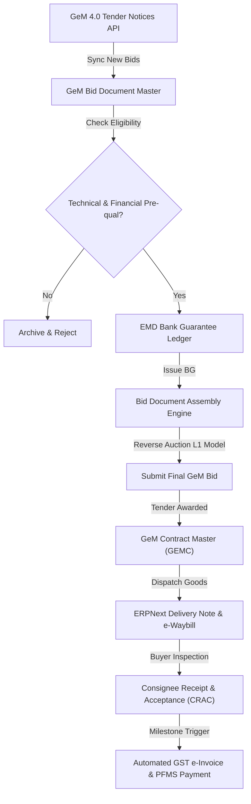

# ERPNext GeM 4.0 Portal Integration & Contract Automation Engine

[](https://frappeframework.com/)
[](https://erpnext.com/)
[]()
[]()
[](LICENSE)

## 📌 Executive Overview & Real-World Client Problem

Indian government procurement on the **Government e-Marketplace (GeM 4.0)** exceeds ₹4 Lakh Crores annually. However, defense, railway, infrastructure, and PSU contractors struggle with:
1. **Missed Bid Addendums & Corrigenda:** Tenders frequently amend technical specs and delivery schedules; manual tracking causes bid disqualification.
2. **Locked Working Capital in EMDs:** Earnest Money Deposit (EMD) Bank Guarantees (BGs) remain blocked in treasury accounts for months without automated expiry alerts or bank release follow-ups.
3. **Delayed Consignee Receipt and Acceptance Certificate (CRAC) Invoicing:** Payment on GeM requires a statutory CRAC generated by the buyer. Delays in converting CRACs into GST-compliant e-Invoices trigger severe PFMS payout bottlenecks.
4. **L1 Reverse Auction Blindness:** Contractors fail to model real-time price-to-win margins under GeM's dynamic reverse auction rules.

This repository provides an enterprise-grade Frappe app that bridges ERPNext Buying, Selling, and Accounts directly into the GeM 4.0 public procurement pipeline.

---

## 🏛️ System Architecture Flow



---

## 🚀 Key Engineering Capabilities

- **Bid Crawl & Document Parsing:** Ingests GeM tender notices, parses BOQ items, and auto-populates ERPNext Item Masters.
- **EMD Bank Guarantee Management:** Tracks BG issuance, SFMS messages, bank margin money, and automated BG return requests upon tender opening.
- **L1 Reverse Auction Simulator:** Predicts competitive bidding thresholds based on vendor seller ratings and cost of goods sold (COGS).
- **CRAC-to-Invoice Automation:** Listens for buyer CRAC approvals via webhook, auto-generates ERPNext Sales Invoices, and prepares digital signature tokens for PFMS disbursements.

---

## 📂 Frappe DocType Schema & Data Structure

```text
gem_portal_bid/
├── gem_portal_bid_core/
│   ├── doctype/
│   │   ├── gem_bid_document/
│   │   │   ├── gem_bid_document.json
│   │   │   ├── gem_bid_document.py
│   │   │   └── gem_bid_document.js
│   │   ├── gem_emd_guarantee/
│   │   │   └── gem_emd_guarantee.json
│   │   └── gem_crac_milestone/
│   │       └── gem_crac_milestone.json
│   └── workspace/
│       └── gem_portal_bid_workspace/
│           └── gem_portal_bid_workspace.json
```

---

## ⚡ Frappe Hooks & Whitelisted APIs

- **REST Endpoint:** `POST /api/method/gem_portal_bid.api.register_incoming_bid`
- **Whitelisted Method:** `@frappe.whitelist() def generate_crac_milestone_invoice(contract_number, crac_id, accepted_qty, unit_price)`
- **DocType Event:** `on_submit` of `Delivery Note` verifies pending CRAC timeline.

---

## 🛠️ Installation & Bench Setup

```bash
# 1. Fetch app into Frappe Bench
bench get-app https://github.com/shyampandey1104/erpnext-gem-portal-bid-contract-engine

# 2. Install on your target site
bench --site erp.yourdomain.com install-app gem_portal_bid

# 3. Run database migrations
bench --site erp.yourdomain.com migrate

# 4. Execute unit test suite
python3 -m unittest discover tests
```

---

## 📄 License
Released under the [MIT License](LICENSE). Built for enterprise scalability and government contracting compliance.
